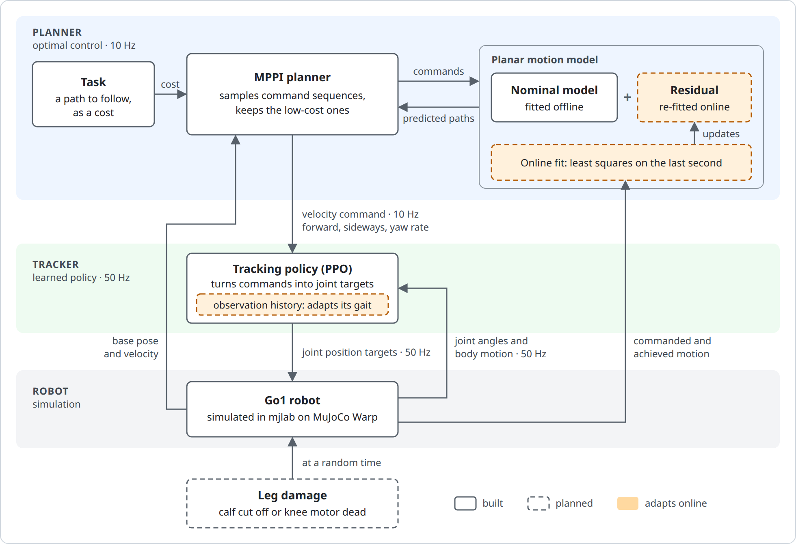

# Ideas and open questions

Each entry has a status: `open` (under discussion), `adopted` (agreed, and reflected in [plan.md](plan.md)) or `dropped` (with the reason). The date is when the entry was raised.

The entries so far came out of two reviews on 2026-11-11, the plan checked against mjlab's code and the LLA-MPPI paper (see [related-work.md](related-work.md)), and the discussions that followed. Entries 3.2, 3.4, 3.5, 3.9 and 3.10 were adopted that day, when the two MPPI demos were built (see [progress.md](progress.md)). Everything else is still open.

## System overview



*The system has two layers, and each adapts online in its own way. The planner re-fits a residual in its motion model from how the robot actually moved (entry 3.11). The policy adapts its gait through its observation history (entry 5.6). Solid boxes exist today, dashed boxes are planned, and orange marks the parts that adapt. Drawn on 2026-11-12.*

The picture is `system.png`, rendered from `system.svg`. When a planned part is built, move its box from the dashed group to the solid group in `system.svg`, then render the PNG again from the repository root:

```sh
google-chrome --headless=new --no-sandbox --hide-scrollbars \
  --force-device-scale-factor=2 --window-size=980,670 \
  --screenshot="$PWD/notes/system.png" "file://$PWD/notes/system.svg"
```

## 1. What makes the project interesting

### 1.1 Frame it as adaptation at two levels, with no predefined damage models

**Status:** `open` · 2026-11-11

The first thought was that our MPPI planner also adapts online. On its own that doesn't set us apart. LLA-MPPI's planner adapts online too, by switching to whichever simulator in its bank fits best, and Nagabandi et al. adapt a learned model online for MPC. Three narrower differences do hold:

- **Fitting instead of selecting.** LLA-MPPI picks one of K damage models written down in advance. We re-fit gains and offsets continuously, so nothing limits us to damages someone listed. Our held-out damages test exactly this, and LLA-MPPI never runs that test.
- **Two layers adapt, not one.** Our policy adapts implicitly through its observation history, and our planner adapts explicitly through least squares. LLA-MPPI has a single adapting layer.
- **Cost.** We solve a least-squares problem with a few parameters each step. They run K full physics simulators in parallel.

Proposed one-line framing: "adaptation at two levels, with no predefined damage models, tested on damages unseen in training."

### 1.2 Risk: the two adapting layers compete

**Status:** `open` · 2026-11-11

If the history policy compensates well, velocity tracking stays accurate after the damage, the fitted motion model stays near identity, and the adaptive planner shows no gain over a fixed one. The planner's adaptation only matters for what the policy cannot fix, such as a lower top speed or a steady drift to one side on three legs.

This is reasoning, not a measured result. Entries 2.2 to 2.4 are there to make the planner's contribution visible if it exists.

## 2. Experiments

### 2.1 The four controllers to compare

**Status:** `adopted` · 2026-11-12

Decided by cpw on 2026-11-12: a two-by-two comparison, where each controller switches one layer's adaptation on or off.

| | Planner with a fixed model | Planner that re-fits a residual online |
|---|---|---|
| **Policy without history** | 1. Baseline | 3. Residual only |
| **Policy with history** | 2. History only | 4. Ours |

cpw named three of the four: ours, the policy with history alone, and the residual with a policy without history. The fourth, with neither, is filled in here as the plain baseline. The rules that keep the comparison fair and the measures are in [tasks.md](tasks.md), section 3.

This replaces the rows assumed on 2026-11-11, which used a simple path follower for the first two.

### 2.2 One pair of rows must isolate the planner's adaptation

**Status:** `open` · 2026-11-11

Use the same policy in both rows, with the planner on a frozen motion model in one and on the online fit in the other. The two-by-two comparison in 2.1 contains this pair twice, once for each policy.

### 2.3 Include damages severe enough to bias tracking

**Status:** `open` · 2026-11-11

The planner needs something left to correct after the policy has adapted (see 1.2). Damages that cap the top speed or cause a steady sideways drift are the likely candidates.

### 2.4 Plot the fitted gains and offsets over time around the chop

**Status:** `open` · 2026-11-11

This is direct evidence that the planner's model changed in response to the damage, separate from the task metrics.

### 2.5 Add a whole-leg-disabled damage

**Status:** `open` · 2026-11-11

Turn off all three motors of one leg. This matches LLA-MPPI's "leg lock" test, where they succeed in 46 of 50 trials, so at least one of our results can sit beside theirs.

### 2.6 Borrow LLA-MPPI's evaluation protocol

**Status:** `open` · 2026-11-11

- 50 randomized trials per condition.
- Success rate and fall rate with 95% confidence intervals.
- Time to goal.
- Controller update time. Their whole-body planner takes 14–18 ms per update. A policy plus MPPI over three velocity commands should be much cheaper, which would be a fair selling point, but we haven't measured ours.

### 2.7 Row 1 should also train across damages

**Status:** `open` · 2026-11-11

The baseline run from 2026-11-10 is an undamaged policy without history. Row 1 should be trained across the same damages as row 2, so that history is the only difference between them.

### 2.8 Which change to test on

**Status:** `open` · 2026-11-12

Not decided: motor faults, a shortened leg, payload, friction, terrain, or several of them. The candidates, a proposal and the reasons are in [tasks.md](tasks.md), section 2. The proposal is to train and test on motor faults on one leg, to test on payload and friction without training on them, to keep the calf cut as a stretch goal, and to leave terrain out. Item S1 in the task list measures how much each candidate changes the robot's planar motion, so the choice can be made on data.

## 3. Planner

### 3.1 A gain and an offset can't be separated under a constant command

**Status:** `open` · 2026-11-11

With a nearly constant command, least squares over the last second can't tell a gain from an offset, because both explain the same velocity error. Two options:

- Regularize the fit toward the previous estimate.
- Fit only the offset when the command barely changes.

This is reasoning, not something we have tested.

### 3.2 The planner command term needs the stock behavior turned off

**Status:** `adopted` · 2026-11-11

Built in `mppi/tracker.py`. It keeps mjlab's command term, switches off resampling, heading, standing and forward-only modes, and writes the command tensor directly. It also recomputes the observation after writing a command, so the policy acts on a new command in the same step, without the 20 ms delay described below.

mjlab's stock velocity command puts 30% of environments in heading mode and 10% in standing mode, and resamples every 3–8 s. For the planner, turn those off or subclass the term, then write the command tensor directly.

The policy acts on a new command one step (20 ms) later, because observations are computed at the end of each step. Checked against the code.

### 3.3 Optional: a simulator bank as a damage identifier

**Status:** `open` · 2026-11-11

LLA-MPPI's model selection would fit mjlab: a second simulation with K parallel worlds, one damage hypothesis each. Each step, write the measured state into every world, apply the same joint targets, step once, and compare the predictions with what the robot did.

- **What it gives:** an explicit damage estimate (which leg, how much) to compare with what our policy infers implicitly.
- **What it doesn't give:** the planar motion model our MPPI uses. To drive the planner we would still need a planar model per hypothesis, for example fitted offline from the policy's rollouts with that damage.
- **Starting values from the paper:** a window of 10 steps, a switching margin of 0.5, 3 wins in a row, errors measured on joint positions. Their ablation found the error is U-shaped in window length, best around 20–25 steps.

Use this only as a model-selection component. Their full controller is not a practical baseline: the code isn't released, they use a Go2, and reimplementing whole-body MPPI would be a project of its own.

### 3.4 Build the planner on a racing task first, not box pushing

**Status:** `adopted` · 2026-11-11, with a change: both were built

Decision: build two demos on the undamaged policy, a race around a circle and a box push, with MPPI planning velocity commands and the RL policy tracking them. Both exist and work; results are in [progress.md](progress.md). The reasoning below is kept as written before the demos. Two of its untested points are now measured:

- **Fast-changing commands are fine.** With commands changing every 0.2 to 3 s, none of 512 robots fell in 60 s.
- **The response lag is real.** The fitted model has a time constant of about 0.3 s for linear velocity and 0.1 s for yaw rate. Including it halves the prediction error.

The question: as a first step, run MPPI over velocity commands with the already-trained baseline policy as the tracker, on either box pushing or racing.

Claude's recommendation is to do it, and to pick racing, meaning a timed lap around a track of waypoints.

- **Racing reuses everything.** MPPI's model is the planar motion model the plan already needs. The command term, the least-squares fit and the evaluation all carry over to the damage experiments. The only new asset is a track.
- **Racing gives the planner's model something to do before any damage.** Near top speed and in tight turns the policy can't deliver what is commanded, so the fitted gains and offsets move away from identity. That eases the risk in 1.2. After damage the limits drop and the planner has to slow down for corners, which makes a clear demo.
- **Box pushing can't use the planar model.** MPPI has to predict the box's motion under contact. The practical way is to roll out in the simulator itself (entry 3.5). That makes box pushing feasible, but it skips the fitted model, which is the project's own contribution. The baseline policy was also never trained with sustained contact, only with brief velocity pushes. Simulator rollouts would at least let MPPI see when the policy stumbles.

Things to watch with the baseline policy:

- **Stay inside the trained command ranges:** forward −1.5 to 2.0 m/s, sideways ±1.0 m/s, yaw ±0.7 rad/s. Checked in the config.
- **Smooth the commands.** In training a command changed only every 3–8 s. MPPI re-plans at 10–20 Hz, so penalize command changes or sample smooth noise. How the policy reacts to fast-changing commands is untested.
- **The model probably needs a response lag.** The robot's velocity doesn't jump to the command. A gain and an offset alone ignore that, and racing is where it matters most. This is reasoning, not a measurement.
- **A cheap first experiment:** drive the baseline policy with step and sweep commands, log commanded against achieved velocity, and see how well a planar model predicts 1–2 s ahead. That tests the plan's "planar model is too simple" risk before any MPPI code is written.

### 3.5 Simulator rollouts as MPPI's model

**Status:** `adopted` · 2026-11-11, for the box-push demo

Instead of a planar model, MPPI can roll out in the simulator: each sample is one parallel world, with the policy running inside it. This needs no hand-written model, so it works for tasks with contact such as box pushing.

- **What it takes in mjlab:** a second environment used only for planning. Before each plan, copy the real world's state into every planning world: the robot's root and joint state, the box's state, and the policy's last action, which is one of its observations. Built in `mppi/tracker.py` and measured: after a copy, a planning world stays within 1e-5 of the real one for 2 s.
- **A trap in the copy:** mjlab caches the last observation. After copying state, the observation must be recomputed, or the policy acts on stale data and the planning worlds diverge within one step.
- **Speed (measured):** a plan with 384 worlds and a 2 s horizon, which is 100 policy steps, takes 0.77 s. The steps run one after another, so the horizon sets the cost more than the number of worlds. With one plan per 0.2 s of motion, the demo runs about 4 times slower than real time. That is fine in simulation, because the real world is frozen while planning.
- **The planner's adapting part drops out.** The plan's adaptation is the least-squares fit of the planar model. Simulator rollouts don't use the planar model, and the planning worlds have the same physics as the real one, so there is no mismatch to fit. After damage, the planning worlds must be told the damage, which makes this the plan's optional oracle planner. If the damage has to be identified instead, it becomes LLA-MPPI's approach (entry 3.3).
- **Two ways to put adaptation back here, if we want it.** Both are reasoning, untested.
  - Fit the simulator's own parameters online, such as the box's mass or the damage. This is not a linear least-squares problem, and it is the ground LLA-MPPI already covers.
  - Keep the planning worlds nominal and fit a small correction to their predicted base motion by least squares. This stays cheap, but the correction is applied after the rollout, so it is not consistent with contacts such as the box.
- **Shared code:** write MPPI once with a swappable rollout function. The sampling and weighting are the same for the simulator rollout and for the planar model, so neither is wasted work.

### 3.6 Test the planner's adaptation early with simple dynamics shifts

**Status:** `open` · 2026-11-11

The least-squares fit can be exercised with the baseline policy, before the chop event or any retraining exists. Use the planar model on a path or racing task, and apply a shift mid-run that mjlab can already make per world: add payload mass, lower the ground friction, or scale down one leg's PD gains. The policy's tracking should degrade and the fitted gains and offsets should move.

This shows early whether the planner's adaptation works at all, and how quickly it reacts. That mjlab can vary these three per world was checked in the code. The experiment itself is untested.

### 3.7 Race on a track with straights and direction changes, not a circle

**Status:** `open` · 2026-11-11

The circle demo showed two limits of a circle as a test (measured, see [progress.md](progress.md)):

- **The lap time was set by the command limits, not by the planner.** In the first version MPPI was limited to the trained range, 0.7 rad/s of yaw, which fixed the lap at about 9.5 s. This entry first called that the policy's limit. That was wrong: the policy turns at up to about 1.9 rad/s when asked (entry 3.9).
- **A circle mostly hides the value of the fitted model.** In steady state the commands are constant, so the response lag doesn't matter. Inside the trained range, the fitted model and the naive one reached the same speed, and the fitted one only stayed closer to the centre line (4 cm against 11 cm). At the wider limits the difference is larger: the naive model is slower and leaves the track.

A figure-eight or a slalom has direction changes, where the lag matters, and straights, where the speed limit matters. It would be a better test for the planner, and later for the online re-fit.

### 3.8 The planner runs sideways when allowed

**Status:** `open` · 2026-11-11

With no cost on heading, MPPI ran the circle at 43 degrees to the track, using the policy's sideways velocity. It was no faster on the circle (same lap time). The demo penalizes it for a nose-first racing line. Worth remembering for the damage experiments: after a chop, moving sideways or at an angle may be the better gait, so a heading cost could hide a useful adaptation.

### 3.9 Take MPPI's command limits from what the policy can do, not from its training ranges

**Status:** `adopted` · 2026-11-11, for the circle race

The policy tracks commands far outside the ranges it was trained on: yaw up to about 1.9 rad/s against 0.7 trained, and forward speed up to about 2.8 m/s against 2.0 trained. Measured with `mppi/sweep_commands.py`. Widening MPPI's limits to forward 3.0 m/s and yaw 1.5 rad/s cut the lap time from 9.6 s to 5.5 s with no falls. Above that the robot starts to fall. Numbers are in [progress.md](progress.md).

This matters for the damage experiments. A damaged robot can do less, so limits that were safe before the chop may make it fall afterwards. The planner then needs limits that shrink with the damage, either from a sweep per damage or from the online fit.

### 3.10 Speed-dependent terms in the planar model

**Status:** `adopted` · 2026-11-11

The plan lists "add speed-dependent terms" as the fallback if the planar model is too simple. They are now in: nine products of each command with the size of each command, fitted in the same least-squares solve.

- **On average they change little:** the error 2 s ahead drops from 0.158 m to 0.151 m.
- **At the limit they matter:** for a command of 3.0 m/s with 1.4 rad/s, the linear fit overstates the yaw rate by 0.20 rad/s and the fit with the terms by 0.11 rad/s.
- **In the race they make the planner consistent:** with the terms, all six planner settings tried lapped in 5.5 to 5.6 s. Without them, one of the six settled into a slower sideways gait at 6.1 s.

Even with the terms the model is still optimistic at the limit. Terms that depend on the current velocity, not only the command, are a possible next step.

### 3.11 How the planner would adapt online

**Status:** `open` · 2026-11-12

Not built yet. Today the planar model is fitted once, offline, and stays fixed during a run.

The MPPI algorithm itself would not change. Only the model it plans with would: its parameters would be re-fitted during the run from the robot's own recent motion. Each plan step already produces one sample for that fit, namely the velocity over the last step, the command that was sent, and the velocity that resulted. The steps would be:

1. Keep the samples from the last second or so.
2. Re-solve the least-squares fit on them, every plan step. It is a tiny problem.
3. Hand the new parameters to MPPI's rollouts for the next plan.

Proposed form, raised on 2026-11-12: a residual model. The offline model stays fixed as the nominal model, and only a small correction on top of it is re-fitted online:

  v_next = nominal(v, u) + residual(v, u)

- **What is fitted:** the nominal model's recent prediction errors, so the target is "what the robot did minus what the nominal model said". With no damage the errors are near zero and so is the residual.
- **Size of the residual:** start with a gain and an offset per axis (6 numbers), as in the plan. A fuller linear residual in the velocity and command is the next step up.
- **How it is fitted:** least squares that forgets old samples gradually and is pulled toward zero. The pull toward zero means the residual only moves when the data shows something, which also covers the cases of too little data and constant commands below.
- **What it gives for free:** the size of the residual is a damage signal. It can be plotted around the chop (entry 2.4).
- **Its limit:** the residual is fitted on what the robot is doing now, so it is only reliable near the current commands. MPPI could plan toward commands where it is wrong. Keeping the residual small in parameter count limits this.

This is close in shape to DATT in the plan's references, which pairs an RL policy with an online adaptive estimator. A residual only on the planar motion should be enough here, because the policy absorbs the change in how the legs must move. LLA-MPPI's disturbance-observer baseline failed on leg lock (0 of 50), but there the residual had to explain whole-body dynamics with no adapting policy underneath.

Three problems to design around, none tested yet:

- **Too little data.** One second is 10 samples, and the full model has 16 parameters per velocity component. Fit only a few parameters online, such as a gain and an offset per axis on top of the offline model, which is what the plan says. Alternatively, pull the fit toward the offline model so that the data only changes what it actually shows.
- **Constant commands** (entry 3.1). With no variation in the command, a gain and an offset cannot be told apart. Pulling toward the offline model handles this too: what the data does not show stays at its old value.
- **Speed against noise.** The gait makes the measured velocity oscillate, so a very short window fits noise. A window of about a second, or a fit that forgets old samples gradually, is the trade-off.

What it should look like at a chop: the model's predictions suddenly miss, and within about a second the fitted gain drops and an offset appears, for example a steady drift to one side. MPPI's predicted paths then bend the way the damaged robot really moves, so it steers against the drift and slows for turns.

The command limits are a separate problem (entry 3.9). A lower gain tells MPPI the robot is slower, but not that a command has become unsafe.

Entry 3.6 describes how to test this before the chop event exists.

## 4. Damage injection

Background: MuJoCo Warp calls each parallel environment a "world". Some model fields can differ per world, including geom size and position, site position and PD gains. The collision settings `contype`, `conaffinity` and `condim` cannot.

Every entry in this section was checked against mjlab's code at commit `936f7a1`. None has been tried in a run yet.

### 4.1 Give the lower-leg capsules friction

**Status:** `open` · 2026-11-11

Go1's lower-leg collision capsules are frictionless (`condim 1`), and only the foot sphere has friction. After a chop the robot would stand on a frictionless stump and slide. `condim` can't vary per world, so set those capsules to `condim 3` in the model for all worlds. Intact legs rarely touch the ground with their lower legs, so normal walking shouldn't change.

### 4.2 Drop the mass change from the chop

**Status:** `open` · 2026-11-11

One Go1 lower leg, foot included, weighs 0.196 kg, which is 1.5% of the robot. Changing `body_mass` makes mjlab rerun its full physics recompute (`set_const`). In an event that runs every step, that recompute happens on every step for every world, even when nothing was chopped. Geometry, site and gain changes need no recompute.

### 4.3 Shrink and shift the geoms

**Status:** `open` · 2026-11-11

Capsules shrink around their centre, so shorten them with `geom_size` and move them up with `geom_pos`. Shrink the foot sphere to almost nothing.

### 4.4 Move or mask the foot site of the damaged leg

**Status:** `open` · 2026-11-11

A site is a named reference point on a body. Go1's foot sites (`FR`, `FL`, `RR`, `RL`) sit at the old foot centre and don't move when the geoms shrink. The reward terms `foot_clearance`, `foot_swing_height`, `foot_slip` and `soft_landing` depend on those sites or on the foot contact sensor, so they would track a foot that no longer exists.

Either move the damaged leg's site to the stump tip (`dr.site_pos`, per world) or mask those terms for that leg.

### 4.5 Relax the pose reward for the damaged leg

**Status:** `open` · 2026-11-11

The pose reward pulls every joint toward the normal stance, which fights a three-legged gait that holds the stump up.

### 4.6 Implement the chop as a class-based "step" event, not an "interval" event

**Status:** `open` · 2026-11-11

mjlab events run at startup, on reset, at intervals, or on every step. Interval events re-arm after firing, so a 20 s episode could be chopped twice. A class-based term running every step can pick one chop time per episode in its `reset` hook and keep a "chopped" flag per environment.

### 4.7 Dead knee motor

**Status:** `open` · 2026-11-11

In Go1's model the knee joint is named `*_calf_joint`. A dead motor is `dr.pd_gains` with `operation="abs"` and gains (0, 0) on that joint. It needs no recompute.

## 5. Policy

### 5.1 History is one setting on the actor's observations

**Status:** `open` · 2026-11-11

The stock Go1 policy sees no history. Milestone 3 is mostly setting `history_length` on the actor observation group. Checked against the code.

### 5.2 A recurrent policy is a cheap ablation

**Status:** `open` · 2026-11-11

rsl-rl's recurrent policy (GRU or LSTM) is already available through mjlab's config, so comparing stacked history with a recurrent policy costs one extra training run.

### 5.3 Let the critic see the true damage

**Status:** `open` · 2026-11-11

Give the critic which leg is damaged, how much, and whether the motor is dead. The task already has a separate critic observation group, and privileged critic inputs usually speed up PPO.

### 5.4 Simulator rollouts will need the policy's history copied too

**Status:** `open` · 2026-11-11

The box-push demo copies simulation state into planning worlds (entry 3.5). That is complete for the current policy, which sees no history. Once the policy has observation history or is recurrent, the history buffers or hidden state must be copied as well, or the planning worlds start with the wrong memory.

### 5.5 Train the policy on wider command ranges

**Status:** `open` · 2026-11-11

The baseline run stopped at the curriculum stage with forward commands up to 2.0 m/s and yaw up to 0.7 rad/s. The next stage, up to 3.0 m/s, starts exactly where the run ended, so it was never trained. The policy already extrapolates to about 2.8 m/s and 1.9 rad/s, but it falls beyond that. Training longer, or with wider ranges for forward speed and yaw, is the remaining way to make the race faster. One training run takes a little over an hour.

### 5.6 What turns the PPO policy into meta-RL

**Status:** `open` · 2026-11-12

History alone is not enough. A policy with history trained only on the undamaged robot has nothing to adapt to and learns to ignore the history. Black-box meta-RL needs three things together:

- **Memory:** the actor sees its recent observations and actions, as a stacked window or through a recurrent network.
- **A distribution of tasks in training:** many damages, starting at random times mid-episode, with some episodes undamaged. The switch has to happen during an episode, or the policy never learns to notice it.
- **A hidden task:** the actor is never told the damage. It has to infer it from how the robot responds to its own actions. The critic may be told (entry 5.3).

Training is still ordinary PPO. The adaptation happens inside the forward pass, with no weight updates at test time. This is the same idea as in-context learning in language models: the history is the context, and the damage is the task inferred from it. With a transformer over a long history it is in-context learning in the literal sense, which is how LocoFormer is usually described.

Options for the memory, from least to most work:

| Option | What it is | Work in mjlab |
|---|---|---|
| Stacked history | The actor's MLP sees the last N observations | One setting, `history_length` |
| Recurrent policy | GRU or LSTM actor, the classic form of black-box meta-RL | A config change, already supported by rsl-rl |
| Teacher and student (RMA) | A teacher sees the true damage as a latent; a student learns to predict that latent from history | Two training phases and an extra network |
| Transformer over a long context | In-context learning in the literal sense | A new policy class and much more compute |

Suggested starting point, not yet tested: stacked history of 0.5 to 1 s, which is one to two gait cycles, with the true damage given to the critic. Use the recurrent policy as an ablation.

Black-box meta-RL is one family of meta-RL, not the whole field. All families train across a distribution of tasks and differ in where the adaptation to a new task happens:

| Family | Where adaptation happens | Example |
|---|---|---|
| Black-box, memory-based | In the policy's memory, with no weight updates | RL², LocoFormer |
| Gradient-based | In the weights, by a few gradient steps at test time | MAML |
| Task inference | In an explicit latent task variable inferred from recent data | PEARL, VariBAD; RMA is a supervised relative |
| Model-based | In a dynamics model that is updated online, then used for planning | Nagabandi et al. |

Black-box fits the policy because the robot has to adapt within seconds, mid-run, with no time for trial episodes or gradient steps. Our planner is a small hand-designed case of the model-based family: its least-squares re-fit is the adaptation, and MPPI is the planning.

Why history helps, in POMDP terms (raised 2026-11-12). The damage can be treated as a hidden part of the state: which leg, how much is cut, whether the motor is dead, and whether the chop has happened yet. With that variable included, the problem is an ordinary Markov problem again, but the policy cannot observe it. That makes it a POMDP, and in a POMDP the best action depends on the belief about the hidden state, which is computed from the history of observations and actions. A policy that sees only the current observation cannot hold a belief, so it can only be robust on average.

- **Why one observation is not enough:** the same joint angles and velocities occur with and without damage. The damage shows in how the robot responds to an action over the following steps.
- **What the memory does:** it plays the role of the belief. A stacked window is a truncated version of it, which is enough if one or two gait cycles identify the damage.
- **The baseline is already a POMDP.** Friction, the centre-of-mass offset and the encoder bias are randomized and hidden from the actor, and it does not see contacts or its height. Without history it is robust to them, not adapted to them.
- **The privileged critic** is the critic being given the hidden state, which is allowed because the critic is only used in training.
- **The planner does the same inference explicitly.** Its residual fit is a point estimate of how the hidden damage changes the planar motion. Pulling the fit toward zero acts as a prior, and forgetting old samples allows the hidden state to change.

Names for this setting that are worth citing, to be checked against the papers: hidden-parameter MDP (Doshi-Velez and Konidaris), hidden-mode MDP for a hidden state that switches (Choi, Yeung and Zhang), and Bayes-adaptive MDP for the meta-RL view (Duff).

Ways to check that the policy really adapts and is not just robust:

- **Against the no-history policy** trained on the same damages (rows 1 and 2 of the experiments table). The gap is the value of adaptation.
- **Recovery curve:** tracking error against time since the chop should fall over a second or two, not jump to a new steady level.
- **History ablation at test time:** blank or shuffle the history. Performance after damage should drop.
- **Probe:** the damage should be decodable from the policy's hidden features.

## 6. Demo and setup

### 6.1 Record the chop video in mjlab itself

**Status:** `open` · 2026-11-11

The plan records the chop in CPU MuJoCo. That may not be needed: mjlab's video renderer copies each world's geom size, position and color. The lower-leg mesh can be hidden and a shortened stump capsule shown in the same run. Checked against the code, not yet tried.

### 6.2 Pin commit `936f7a1`, not the v1.6.0 tag

**Status:** `open` · 2026-11-11

The fork is v1.6.0 plus 60 commits, including the upgrade from MuJoCo 3.11 to 3.16. The baseline ran on that commit, so pinning it keeps later runs comparable.
